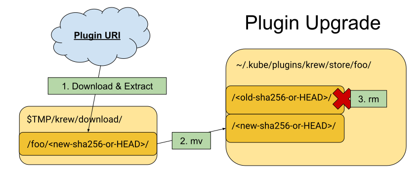
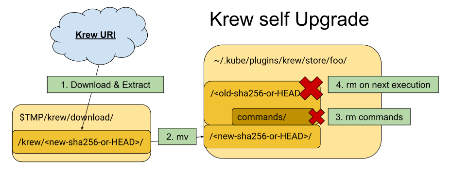

# Plugin Lifecycle

(This guide is intended for developers of Krew.)

:warning: This document describes the general plugin lifecycle. Exact paths
and receipt handling have changed since v0.2; see
[Krew Architecture](KREW_ARCHITECTURE.md) and the source code for current
details.

## Installation

The plugin archive is downloaded and checked against its sha256 to verify
integrity. It is uncompressed into a staging directory called
`${TMP}/krew/download/<plugin-name>/<version>/`. The selected files are then
moved to `~/.krew/store/<plugin-name>/<version>/`. Krew writes an install
receipt to `~/.krew/receipts/<plugin-name>.yaml` and creates a `kubectl-*`
symlink in `~/.krew/bin`. The move keeps the operation partially atomic and
idempotent on most file systems.

## Upgrade

Upgrading is more difficult because we already have a plugin that is working.
Krew should not destroy a working environment. The operations should be
idempotent. If something fails we should be able to recover to the wanted state.

Upgrading works by iterating over install receipts, comparing each installed
version with the version in the corresponding index, and installing the plugin
again when the versions differ.

Install the plugin:

1. Delete the old version
2. Therefore it‘s not possible for plugins to store
   data in the plugin directory.

If a plugin operation does not succeed, the existing plugin directory is not
damaged under the assumption that the move is atomic. If another install or
upgrade command is issued and a staging directory still exists, or two version
directories exist under `store/<plugin-name>/`, krew treats the previous
operation as failed.

Krew informs the user and retries to reinstall the package.

On Windows it is not possible to modify a file/directory which is currently in
use. This requires a special case for upgrading krew, which itself is a plugin,
from krew. If krew upgrades itself, it is installing itself, instead of deleting
the whole old directory it just deletes the old `/commands/` directory witch
holds all the plugin descriptor files.

This way only the new krew version is executed. If krew upgrade is executed
again the old version directory gets deleted.
